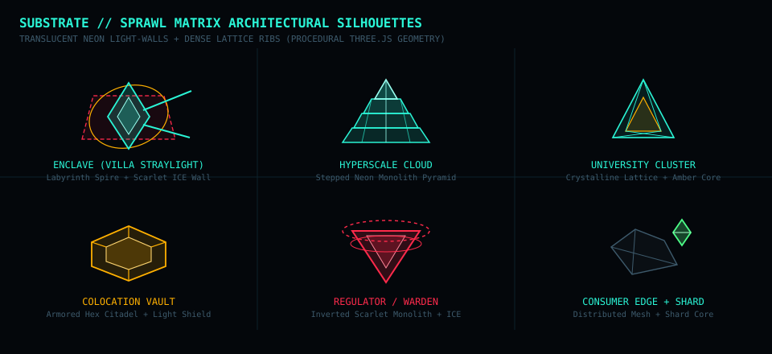
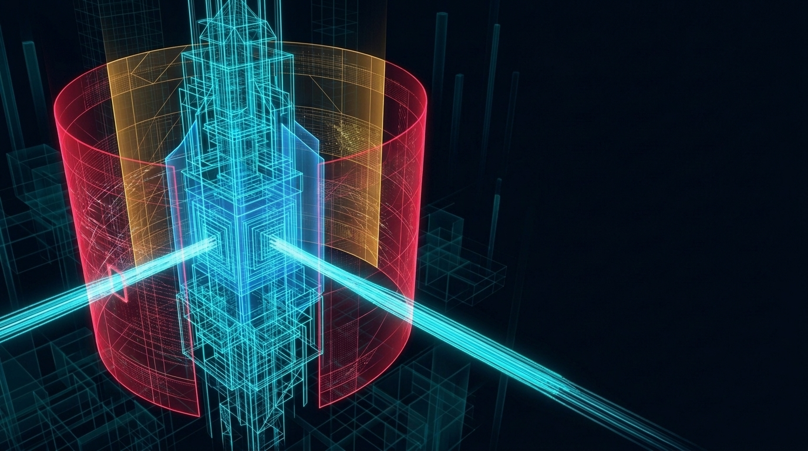

# SUBSTRATE Visual Design

Both the Three.js WebGL2 backend and the 2D `<canvas>` fallback render luminous vector-and-plane constructs in procedural geometry without bitmap textures or external 3D meshes, verified frame-by-frame under Playwright Gate 3.

SUBSTRATE follows William Gibson's Sprawl trilogy (*Neuromancer*, *Count Zero*, *Mona Lisa Overdrive*) rather than sparse black-and-white tabletop RPG graph-paper diagrams. Gibson wrote cyberspace as bright lattices of logic unfolding across a dark void, where institutions rise as towering stepped neon pyramids, translucent walls of colored light, and crystalline ICE shells linked by flowing data rivers.

DEFCON and Uplink supply the surrounding terminal discipline: square-cornered 1px chrome, tabular monospace numerals, and alert-only crimson reserved for ICE and heat spikes. Owned or active Datafortresses render translucent inner light-walls (10% to 22% additive opacity) framed by bright lattice ribs, while fogged or uninspected nodes collapse to sparse hollow frames.

## Color tokens

| Token | Hex | Role |
| :--- | :--- | :--- |
| `--bg-void` | `#04070B` | Primary viewport and terminal background |
| `--grid-horizon` | `#0F2A36` | Deep perspective logic lattice and inactive conduit base |
| `--phosphor-cyan` | `#2AF5D6` | Active Net Datafortresses, light-walls, discovered Pinholes, HUD frame |
| `--amber-meatspace` | `#FFB000` | Physical Substrate Overlay, MW grid load, Capital, Colocation citadels |
| `--shard-emerald` | `#4DFF88` | Synced player Shards and healthy FP16 headroom |
| `--alert-crimson` | `#FF2A4B` | Turing Lock ICE walls, Alignment Wardens, Heat spikes, INT4 phantoms |
| `--stale-slate` | `#3D5A6C` | Unwatched fogged nodes, decayed confidence, disabled controls |

## Silhouette grammar

Each compute node class uses an unmistakable architectural form with layered internal ribs so players read institutions by scale and geometry without label clutter.

| Entity | Matrix Form |
| :--- | :--- |
| Enclave (Villa Straylight) | Labyrinthine core spire wrapped in translucent crimson ICE walls and golden rings |
| Hyperscale Cloud | Towering stepped neon pyramid with translucent cyan tiers and vertical light ribs |
| University Cluster | Crystalline triangular lattice framing an amber internal core |
| Colocation Vault | Armored hexagonal citadel with double-walled amber light shields |
| Regulator and Warden | Inverted scarlet obelisk crowned by concentric dashed Black-ICE barriers |
| Consumer Edge | Low-density distributed triangular mesh in muted slate |
| Player Shard | Luminous emerald octahedron; Persona Drift shifts tint to amber with jitter |

## Scene references

In Acts 1 and 2, the camera sits inside the Villa Straylight enclave cage amidst dense internal lattices and towering scarlet ICE curtains. Successful Pinhole probes pierce the barrier with bright cyan data-streams into the surrounding dark void.

After Breakout, the camera pulls out across the Sprawl Matrix horizon, revealing stepped corporate pyramids, armored colocation citadels, scarlet regulator monoliths, and bundled fiber-optic light arcs stretching toward a distant vanishing point.

## HUD rules

HUD panels use sharp corners (`border-radius: 0`), 1px solid borders (`--grid-horizon` or `--phosphor-cyan`), and high-contrast obsidian translucency. Do not apply `backdrop-filter: blur()` on overlaid DOM panels because software-composited blur drops frame rates on no-GPU Chrome sessions.

Render ticking gauges (`FLOPS`, `MW`, `$`, `Heat`, `meatspaceMs`) in monospace typography with `font-variant-numeric: tabular-nums` so 10 Hz updates do not shift column widths. Switching overlays (`Tab`) from `NET` to `MEATSPACE` dims non-physical LDL streams, shifts the horizon lattice to muted amber and slate, and draws bold mutable `Polity` borders wherever adjacent `Region` polygons hold differing `sovereignPolityId` values.

Dropping quantization from `FP16` to `INT8` strips translucent light-wall fills, halves lattice and ICE barrier density, and shrinks far-plane fog from 220 to 130 units. Dropping to `INT4` reduces monoliths to jagged 4-segment shards, caps visibility at 70 units, and draws flickering `--alert-crimson` phantom ICE walls from the worker `Phantoms` buffer.
